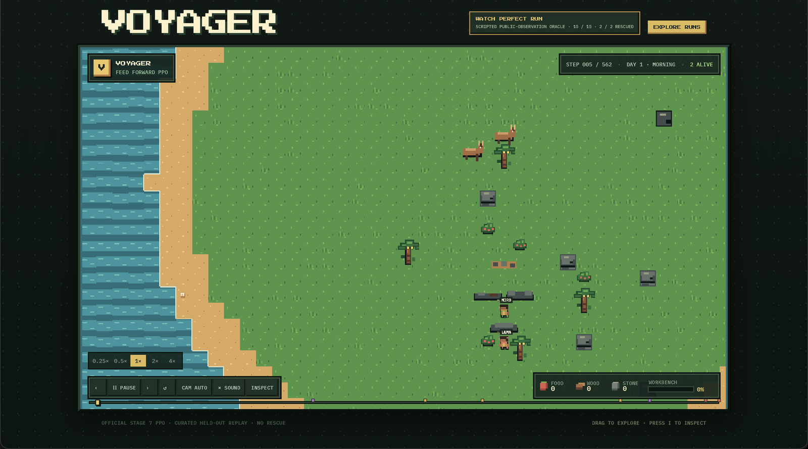
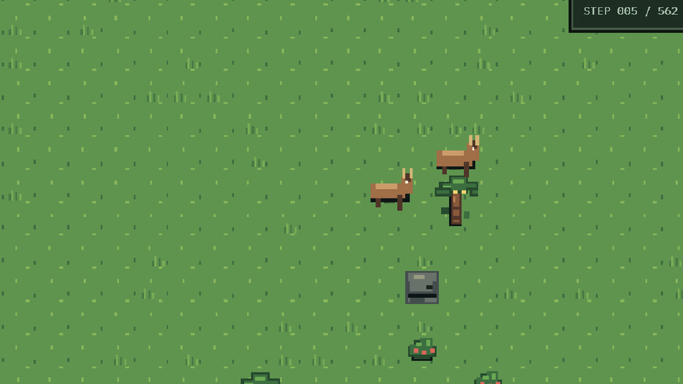
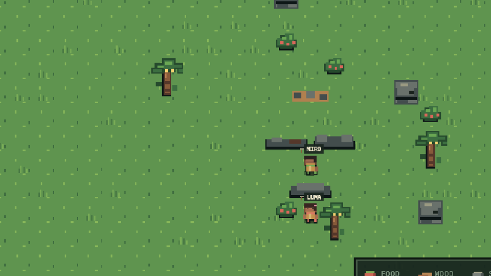
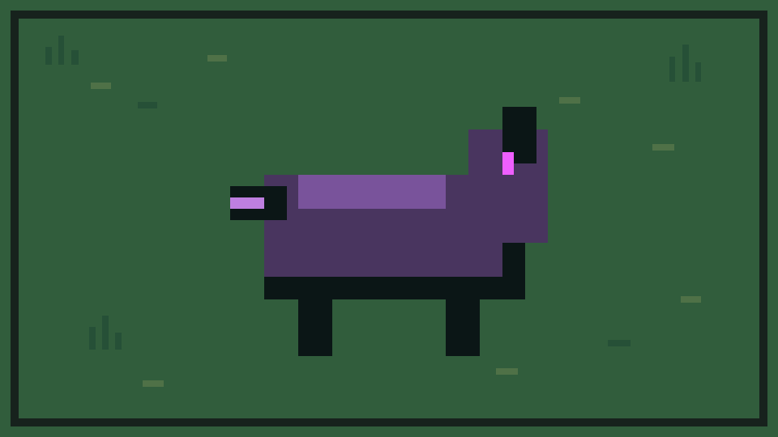
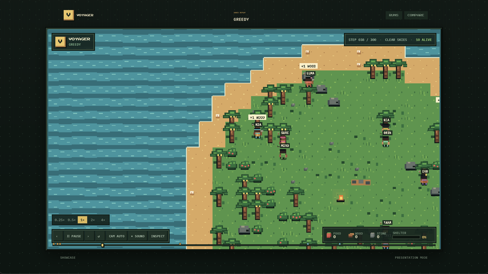
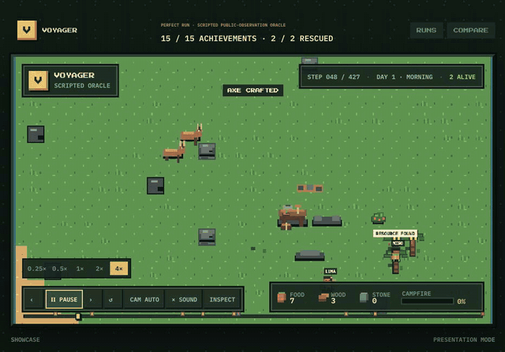
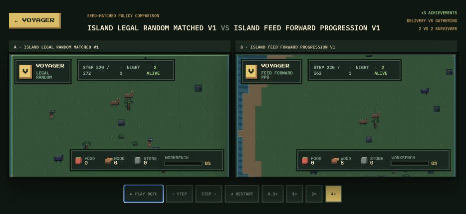
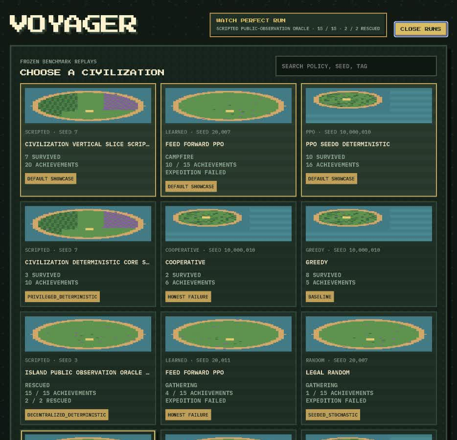
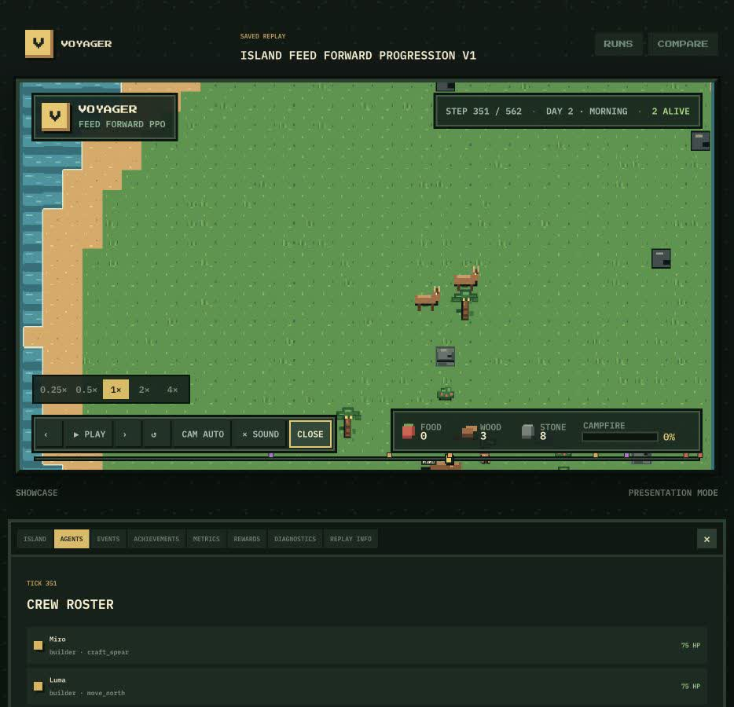

# Voyager

[](https://github.com/fawzmehfil/Voyager/actions/workflows/ci.yml)

[](LICENSE)

**A cooperative survival world for evaluating multi-agent reinforcement learning.**

Two decentralized agents must explore procedural islands, gather finite resources, build
shared infrastructure, survive the night, and complete a rescue beacon. Voyager measures
whether learned policies can coordinate from partial observations and delayed rewards, then
transfer those skills to held-out worlds.

<p align="center">
  
</p>

<p align="center">
  <a href="BENCHMARK.md">Benchmark card</a> · <a href="benchmarks/reference/voyager_island_v1_baselines_v1/report.md">Frozen results</a> · <a href="docs/stage_7_island_benchmark_v1.md">Environment contract</a> · <a href="CONTRIBUTING.md">Contributing</a>
</p>

## Overview

Voyager evaluates meaningful achievements rather than reward alone. The benchmark focuses on
a shared two-agent task, where each agent acts from a local 7×7 view and a small public camp
board.

Voyager tests whether policies can:

- **Coordinate:** divide gathering, delivery, construction, and survival work.
- **Plan across delays:** connect early actions to shared outcomes hundreds of steps later.
- **Generalize:** repeat those behaviors on held-out procedural islands.

Fifteen achievements show where a plan breaks. Frozen data splits, deterministic simulation,
conservation ledgers, and replay files keep each result reproducible.

The full capability chain is:

```text
explore -> gather -> return -> deposit -> build -> craft
        -> hunt -> cook -> shelter -> survive -> signal -> rescue
```

<table>
  <tr>
    <td width="25%" align="center"></td>
    <td width="25%" align="center"></td>
    <td width="25%" align="center"></td>
    <td width="25%" align="center"></td>
  </tr>
  <tr>
    <td align="center"><sub>Finite wildlife and food</sub></td>
    <td align="center"><sub>Two agents, one shared economy</sub></td>
    <td align="center"><sub>Night stalkers punish weak plans</sub></td>
    <td align="center"><sub>The original ten-agent benchmark</sub></td>
  </tr>
</table>

## Watch a complete run

This is the public-observation scripted oracle completing all 15 achievements and rescuing
both agents. It runs at 4× speed. The oracle is a solvability check, not a learned result.

<p align="center">
  <a href="media/voyager-rescue-run.mp4"></a>
</p>

<p align="center">
  <a href="media/voyager-rescue-run.mp4">Watch the full-quality MP4</a> · <a href="#replay-viewer">Open the replay collection</a>
</p>

## What Voyager measures

Each `VoyagerIsland-v1` episode contains:

- Two symmetric agents sharing one policy.
- A procedurally generated 48×48 island and a 1,200-tick limit.
- Local 7×7 observations plus a small public camp board.
- Nineteen discrete actions with authoritative action masks.
- Finite food, wood, stone, deer, tools, structures, and night threats.
- Fifteen achievements spanning gathering, delivery, production, survival, and rescue.

The hard part is composition. An agent may learn how to collect wood, yet still fail to
remember why it left camp, return with the wood, deposit it, and coordinate the next build.
Voyager makes those partial successes visible instead of reducing the episode to one win or
loss.

## Official baseline result

The first frozen evaluation trained feed-forward PPO and recurrent PPO with three independent
training seeds and one million agent transitions per run. Checkpoints were selected on 50
development islands, then evaluated once on 100 held-out islands. Seeded-stochastic inference
is the primary learned-policy result.

| Policy | Public score | Hierarchical 95% CI | First night | Rescue |
|---|---:|---:|---:|---:|
| Legal random | 0.023 | 0.019–0.026 | 17% | 0% |
| Feed-forward PPO | **0.164** | 0.049–0.198 | 94% | 0% |
| Recurrent PPO | 0.072 | 0.032–0.106 | 94% | 0% |
| Scripted oracle | **0.986** | 0.973–0.997 | 100% | 96% |

Feed-forward PPO learned basic gathering on 91–96% of islands, resource delivery on 65–72%,
workbench construction on 61%, and a first tool on 56%. It did **not** learn shelter,
hunting, cooking, beacon construction, or rescue. Recurrent PPO did not improve on it under
the same budget.

That is the result: early cooperative progression is learnable and significantly exceeds
random, while the complete task remains unsolved by these PPO baselines. The oracle's 96%
rescue rate shows that the mechanics are solvable without privileged simulator state.

<p align="center">
  
</p>

Full tables, confidence intervals, source hashes, and achievement-level results live in
[`benchmarks/reference/voyager_island_v1_baselines_v1`](benchmarks/reference/voyager_island_v1_baselines_v1).
The frozen protocol is documented in
[`docs/stage_7_island_benchmark_v1.md`](docs/stage_7_island_benchmark_v1.md).

<details>
<summary>Earlier compact benchmark</summary>

Before `VoyagerIsland-v1`, Voyager used a shorter ten-agent survival task. Across three PPO
training seeds, the official deterministic family retained all 10 agents, completed the
shelter, and scored 89.42 with a 95% confidence interval of 84.19–93.17. That result proved
the training, checkpointing, held-out evaluation, and replay pipeline. It is not directly
comparable with the harder two-agent island score above.

</details>

## Quick start

### Run the visual demo

The Docker image builds the Python service and React viewer together:

```bash
git clone https://github.com/fawzmehfil/Voyager.git
cd Voyager
docker build -t voyager .
docker run --rm -p 8000:8000 voyager
```

Open [http://127.0.0.1:8000](http://127.0.0.1:8000).

For a local development install:

```bash
python3 -m venv .venv
source .venv/bin/activate
python -m pip install -e ".[dev]"
npm --prefix web install
npm --prefix web run build
voyager-web
```

The distribution name is `voyager-island` because `voyager` is already used on PyPI. The
Python import remains `voyager`.

### Use the environment

Voyager exposes the benchmark through a conventional PettingZoo parallel factory:

```python
from voyager.envs.island_v1 import parallel_env

env = parallel_env(procedural=True)
observations, infos = env.reset(seed=0)

while env.agents:
    actions = {
        agent: env.action_space(agent).sample(mask=infos[agent]["action_mask"])
        for agent in env.agents
    }
    observations, rewards, terminations, truncations, infos = env.step(actions)
```

For controllers that emit both actions together, use the separately named, checker-compliant
Gymnasium interface:

```python
import gymnasium as gym
import voyager  # registers the environment

env = gym.make("VoyagerIslandCentralized-v1")
observation, info = env.reset(seed=0)
observation, reward, terminated, truncated, info = env.step(env.action_space.sample())
```

Complete runnable versions are in `examples/random_rollout_pettingzoo.py` and
`examples/random_rollout_gymnasium.py`. `VoyagerIsland-v1` remains the benchmark and
PettingZoo environment name; it is intentionally not registered as a Gymnasium environment.

### Train a baseline

TensorFlow training currently requires Python 3.11 or 3.12:

```bash
python3.12 -m venv .venv-train
source .venv-train/bin/activate
python -m pip install -e ".[dev,train]"

python examples/run_stage7_island_procedural.py train \
  --algorithm feed_forward_ppo \
  --training-seed 0
```

Use `--smoke` for a short integration check. An official run uses one million agent
transitions; the full frozen matrix contains three feed-forward and three recurrent runs.

## Replay viewer

The viewer plays recorded evaluation episodes. It does not retrain agents or simulate outcomes
in the browser. Every tick comes from a versioned replay with state hashes and conservation
checks.

It supports exact seeking, event markers, free and automatic cameras, agent inspection,
achievement timelines, metrics, diagnostics, and synchronized policy comparison.

<table>
  <tr>
    <td width="50%" align="center"></td>
    <td width="50%" align="center"></td>
  </tr>
  <tr>
    <td align="center"><sub>Curated benchmark replays</sub></td>
    <td align="center"><sub>Agent and event inspection</sub></td>
  </tr>
</table>

Useful routes after running `voyager-web`:

- `/`: curated showcase and replay library.
- `/replays/{replay_id}`: full viewer and inspector.
- `/compare?left=...&right=...`: synchronized seed-matched comparison.
- `/present/{replay_id}`: clean presentation mode.
- `/api/v1/replays`: read-only replay API.

## Technical shape

| Layer | Implementation |
|---|---|
| Simulation | Python, NumPy, deterministic simultaneous-action core |
| RL interface | PettingZoo Parallel API and Gymnasium registration |
| Baselines | Shared-policy feed-forward PPO, recurrent PPO, legal random, scripted oracle |
| Training | TensorFlow actor-critic models, GAE, action masking, checkpoint selection |
| Evaluation | Frozen seed manifests, 15 achievements, geometric-mean score, bootstrap CIs |
| Replays | Versioned compressed artifacts, hashes, snapshots, conservation ledger |
| Viewer | FastAPI, React, TypeScript, Phaser, procedural pixel art |

The canonical benchmark is deliberately smaller than Voyager's older civilization sandbox.
The sandbox supports ten agents, targeted actions, transfers, spoilage, repair, and revival;
`VoyagerIsland-v1` keeps only the mechanics needed to test one clear cooperative capability
chain.

## Project status

The environment, frozen protocol, six official PPO runs, held-out evaluation, statistical
export, scripted oracle, and curated Replay 2.3 collection are complete. The learned-rescue
release gate failed: PPO progressed but did not beat the island.

The next release milestone is packaging rather than changing the result: publish large
checkpoints and raw reproducibility artifacts, finish the technical report, and ship a clean
installable research release. Future algorithms can then attack the measured gap without
moving the benchmark.

For the full development history and failed experiments, see
[`docs/technical_report_progress_notes.md`](docs/technical_report_progress_notes.md).

## Scope and limitations

Voyager measures decentralized team capability acquisition under shared resource constraints.
It does not yet establish emergent specialization, negotiation, human-like social intelligence,
or cooperation with unfamiliar partners. Both agents are symmetric and can perform every
action.

The official observation is structured rather than pixel-based. PPO and recurrent PPO are the
only learned reference algorithms, uncertainty is estimated from three training seeds, and no
learned baseline reaches rescue under the frozen one-million-transition budget.

## Citation and license

Citation metadata is provided in [`CITATION.cff`](CITATION.cff). Voyager is released under the
[MIT License](LICENSE).
